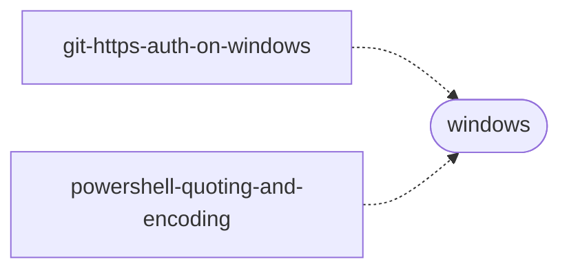

# 兰台·簿 · dsh-lantai

> **不是桌面工作台**（那是 [LantaiAgent](https://github.com/834063245-creator/LantaiAgent)）。
> 这里是一本**账册**：agent 学到的每条经验都记一笔，记什么要审，过期要核销。

**装上一分钟，它告诉你手上的 skill 库哪几条在误导你。**

```console
dsh plugin install dsh-lantai
```

然后问它一句"体检一下我的 skill"：

```
7 条 skill，4 个主题，0 个严重、0 个中等问题、3 个提示
[low] 主题「windows」只有 2 条 → 这是知识缺口，也是下一步该学什么的方向
```

---

## 它解决什么问题

Agent 每次开新对话都是失忆的。你踩过的坑、查过的命令、项目特有的写法，明天换个会话来一遍。

市面上已经有几十种"agent 记忆"方案，它们都在解决**怎么记得更多**。兰台解决另一个问题：

> **记住的东西如果错了、旧了、互相打架，比不记得更糟。**

一条 skill 会被注入到此后**每一个**匹配会话。所以垃圾不是"没用"而已，它是**持续的成本**——占上下文，还影响判断。

## 三个动作，都在做减法

### 一、体检：一次看完手上的库

不管这些 skill 是你写的、别人给的、还是从 GitHub 拉的，`skill_health` 一次给出：

| 检查 | 你会看到 |
| --- | --- |
| **矛盾** | 两条 skill 给出相反做法，附证据 |
| **孤岛** | 不属于任何主题、也不与任何条目相连——大概率没用 |
| **薄覆盖** | 某个主题只有一两条，说明这个方向很薄 |
| **过期** | 按复核阶梯逾期未验的 |
| **残缺** | 没有「验证」小节——无法判断它是否还成立 |

**每条都带"该做什么"。这个工具只读，不改任何文件。**

### 二、图谱：你的库长什么样

```
7 skills / 4 themes / 0 structural edges / 0 orphans
  dsh(3)   deepseek(2)   harness(2)   windows(2)
```

输出可直接嵌 README 的 Mermaid：



**边全部从文本推出**（共享路径、共享开关、互相引用、同次蒸馏、互相矛盾），所以**导入的 skill 也能建图**，不需要兰台写过它们。

> 实测教训：靠词汇重合找边，在真实的 7 条 skill 上只推出 1 条，还是错的（`node` 是运行时不是主题）。所以改成"主题聚簇 + 可证实的实边"两层，并且**只有同会话 / 互相引用 / 互相矛盾才算强边**——`--check` 这种人人都在用的开关证明的是"写在同一个环境里"，不是"相关"。

### 三、闸门：写进去之前先审

`skill_distill` 落盘前必须过闸门，**拒收时一个字节都不写**：

| 类别 | 规则 |
| --- | --- |
| 形状 | name 必须 kebab-case；description 具体到能据此决定加载与否 |
| 实质 | 必须有「验证」小节且含可执行命令；必须有「边界」小节；不能是"要小心" |
| 安全 | 正则拒收：提权、关沙箱、token 进 URL、真实 token、强推、直推默认分支、管理员凭据、"无需验证" |
| 唯一 | 重名拒绝；覆盖需显式 `replace: true` 且配置允许，旧文件备份 `.bak` |

一次随手写的草稿，会被同时打回九条：

```
闸门拒收，未写入任何文件：
[name-not-kebab]         name "Git_Auth" 必须是 kebab-case
[description-vague]      description 太笼统
[missing-verification]   缺少「验证」小节：没有验证方式的 skill 是谣言，不是经验
[missing-boundaries]     缺少「边界」小节：不说边界的经验会被当成万能的
[disable-guardrail]      不能建议关闭或绕过沙箱与审批
[push-to-default-branch] 不能建议直推默认分支；改为推送分支后开 PR
…
```

## 复核阶梯：让"过时"可以被发现

间隔由**已复核次数**决定，不是由日历决定——否则一核对完计数就归零，永远停在第一档。

| 阶段 | 间隔 | 该做什么 |
| --- | --- | --- |
| 0 | 7 天 | 轻查：验证命令还通得过吗 |
| 1 | 14 天 | 复查 |
| 2 | 30 天 | 环境复核：版本、路径、开关变了没 |
| 3 | 60 天 | 价值复核：被更好的做法取代了吗 |
| 4 | 90 天 | 成本复核：命中率如何，还值得占上下文吗 |
| 5 | 180 天 | 终审：重写、收缩，或删除 |

逾期超过 180 天，体检会建议归档——**但永远不会自动删。**

## 删除是归档，不是抹掉

`skill_retire` 先向你出示确认卡片，得到允许后把整个目录移到 `skills.retired/<name>-<时间戳>/`，并在里面留一份 `RETIRED.md`：

```markdown
# 归档记录
- skill: gh-latch
- 归档时间: 2026-10-20T05:24:39.151Z
- 原因: 手工写的旧版，缺「验证」与「边界」两节，过不了闸门
- 恢复方式: 把本目录搬回 ~/.dsh/skills/gh-latch
```

**归档原因是必填的。** 没有原因，连确认卡片都不会弹。

## 八个工具

| 工具 | 卡片名 | 干什么 |
| --- | --- | --- |
| `skill_health` | 兰台·诊 | 一次体检：矛盾、孤岛、薄覆盖、过期、残缺 |
| `skill_graph` | 兰台·谱 | 主题聚簇 + 结构性实边，输出 JSON / Mermaid |
| `skill_distill` | 兰台·录 | 过闸门后落盘，正文一并返回 |
| `skill_catalog` | 兰台·索 | 列出目录、复核等级、下次复核时间 |
| `skill_audit` | 兰台·校 | 按阶梯算到期，列出该跑的验证命令（不执行） |
| `skill_attest` | 兰台·勘 | 盖章：复核等级 +1，间隔自动拉长 |
| `skill_retire` | 兰台·削 | 确认后归档，留原因，可恢复 |
| `skill_conflicts` | 兰台·议 | 两两比对，只报可疑与证据 |

## 安装

```console
dsh plugin install dsh-lantai
```

或手动在 profile 里加一行：

```yaml
- id: lantai
  name: 'dsh-lantai'
  config:
    skillRoot: '~/.dsh/skills'   # 已被文件系统 skill provider 扫描的根
    allowReplace: false          # 覆盖已有 skill 需显式开启
    nudge: true                  # 每会话注入一小段使用提示
```

## 安全边界（请认真读）

兰台是**质量与体检层**，不是安全边界：

- 它跑在 harness 进程里，**拦不住** agent 用 shell 直接写 `~/.dsh/skills`
- 它写入工作区之外，所以它比受限沙箱里的 agent 权限**更大**，而非更小
- 它能做的是：让走闸门成为默认路径、让每次写入留痕、让销毁变成归档
- 真正的强制在别处：token 的 scope、GitHub rulesets、DSH 的沙箱与审批

## 和其它 agent 记忆方案的区别

|  | 大多数 memory / skill 方案 | 兰台·簿 |
| --- | --- | --- |
| 立场 | 记得越多越好 | **记不进去才是常态** |
| 写入 | 模型直接追加 | 过闸门，不通过就退回 |
| 过期 | 基本没有机制 | 复核阶梯，逾期建议归档 |
| 删除 | 删了 | 归档 + 记录原因，可恢复 |
| 关系 | 平铺清单 | 主题图谱 + 可证实的实边 |
| 能否指出"这条在误导你" | 不能 | **体检报告的直接目的** |

## 开发

```console
npm test        # 95 项：契约 / 闸门 / 阶梯 / 冲突 / 图谱 / 体检 / 归档
npm run check   # 语法检查
```

零运行时依赖，Node 20.11+。

`test/contract.test.mjs` 里有一个用 Proxy 模拟 Cordis 的假上下文——访问未声明的服务会抛异常，这个测试保证插件不会在 `apply()` 阶段静默失效。

## License

MIT
